# MYDIAGRAM.md — Diagram Alur Aplikasi POS

> Diagram alur aplikasi: POS kasir, KDS dapur, pesanan online, pembayaran,
> cetak struk, laporan, analytics, dan mode offline.

## Legend

- **Warna biru** = komponen klien (browser/React)
- **Warna hijau** = server function / logika murni (`src/server/`)
- **Warna oranye** = database (PostgreSQL + Prisma)
- **Warna kuning** = file / storage (IndexedDB, upload)
- **Warna merah** = printer eksternal (ESC/POS Web Serial)

## Full Application Flow

```mermaid
flowchart TD
    %% ===== AUTH & GUARD =====
    subgraph AUTH["Auth & Role Guard"]
        A1[Google OAuth] --> A2[Better Auth Session]
        A2 --> A3{role di DB}
        A3 -->|OWNER| A4[Full access]
        A3 -->|KASIR| A5[Kasir + Dapur]
        A3 -->|MEMBER| A6[Pesanan online + Riwayat]
        A3 -->|guest| A7[Login / Public pesanan]
    end

    %% ===== POS KASIR =====
    subgraph POS["POS - Kasir"]
        P1[kasir route] --> P2[KasirDataFn]
        P2 -->|"kasirData: produk, meja, member, delivery"| PDB[(PostgreSQL)]
        P1 -->|"keranjang TanStack Store"| P3[PanelBayar]

        P3 -->|"POST /api/v1/transaksi"| P4[postingTransaksi]
        P4 -->|"Zod: PostingTransaksiSchema"| VAL1[validations/transaksi.ts]
        P4 -->|"atomic $transaction"| P5[Simpan: Transaksi + Items + Pembayaran]
        P4 -->|"kurangi stok produk + bahan"| P6[Update Stok]
        P4 -->|"hitung HPP dari resep"| P7[HPP per item]
        P5 --> PDB
        P6 --> PDB
        P4 -->|"buat Jurnal AKUN"| P8[Jurnal: Kas 1100, Pendapatan 4100, HPP 5100]
        P8 --> PDB

        P3 -->|"poin member redeem"| P9[hitungRedeem]
        P4 -->|"poin member dapat"| P10[Poin = floor total / 10.000]
        P9 --> PDB
        P10 --> PDB

        P3 -->|"offline (IndexedDB)"| P11[Outbox antreanBaru]
        P11 --> P12[(IndexedDB)]
        P12 -->|"sync saat online"| P4
    end

    %% ===== KDS Dapur =====
    subgraph KDS["KDS - Dapur"]
        K1[dapur route] --> K2[DapurDataFn]
        K2 -->|"status MENUNGGU/DIPROSES"| K3[KDS table]
        K2 --> PDB
        K3 -->|"ubah status"| K4[updateStatusPesananFn]
        K4 --> K5[z.enum MENUNGGU/DIPROSES/SELESAI/DIBATALKAN]
        K4 --> PDB

        P4 -->|"Transaksi baru"| K3
        PE12 -->|"pesanTransaksi"| P4
    end

    %% ===== Pesanan Online =====
    subgraph ONLINE["Pesanan Online Public"]
        PE1[pesanan route] --> PE2[Pesanan component]
        PE2 -->|"GET /api/v1/pesan"| PE3[pesananData]
        PE3 -->|"filter aktif=true"| PE4[Daftar produk + meja]
        PE3 --> PDB
        PE2 -->|"POST /api/v1/pesan"| PE5[pesamTransaksi]
        PE5 --> PE6[PostingTransaksiSchema.parse]
        PE6 --> PE12[kasirId=null, statusPesanan=MENUNGGU]
        PE12 --> P4
        PE5 -->|"offline mode"| PE7[Outbox antrean]
        PE7 --> PE8[(IndexedDB)]
        PE8 -->|"online kembali"| P4
    end

    %% ===== Cetak Struk =====
    subgraph PRINT["Cetak Struk ESC/POS"]
        PR1[kasir / dapur / member route] --> PR2[cetakStrukFn]
        PR2 --> PR3[Increment cetakOwner / cetakKasir]
        PR3 --> PDB
        PR2 -->|"mode printer_escpos"| PR4[printer.ts]
        PR4 -->|"navigator.serial"| PR5[ESC/POS Printer]
        PR5 -->|"Web Serial API"| PR1
    end

    %% ===== Laporan & Export =====
    subgraph LAPORAN["Laporan & Export"]
        L1[laporan route] --> L2[LaporanPenjualanFn]
        L2 -->|"requireOwner"| L3[laporanPenjualan]
        L3 --> L4[Query Transaksi dari DB]
        L4 --> PDB
        L3 -->|"bangunRekap ringkasBaris"| L5[Aggregate omzet hpp laba]
        L2 -->|"GET /api/v1/laporan-penjualan"| L6[REST API]
        L6 -->|"format csv|xlsx|pdf"| L7[eksporCsv eksporXlsx eksporPdf]
        L7 --> L8[File download response]

        L9[laporan route: analytics tab] --> L10[KunjunganDataFn + DeviceVisitDataFn]
        L10 -->|"PageVisit + DeviceVisit"| PDB
        L10 -->|"grup harian/mingguan/bulanan"| L11[Aggregation per periode]
    end

    %% ===== Device Tracking (client) =====
    subgraph TRACK["Device & Analytics Tracking"]
        T1[__root route loader] --> T2[recordDeviceVisit]
        T2 -->|"POST /api/v1/device-visit"| T3[deviceVisit]
        T3 -->|"owner/kasir dikecualikan"| T4[ParseDeviceVisitSchema]
        T4 --> T5[Save: deviceId os klasifikasi lokasi userId]
        T5 --> PDB

        T6[__root on page load] --> T7[recordPageVisit]
        T7 --> T8[PageVisit.create]
        T8 --> PDB
    end

    %% ===== Cross-cutting =====
    subgraph XCROSS["Cross-cutting"]
        X1[Transaksi] -->|"poin member"| X2[Member poin update]
        X1 -->|"diskon member"| X2
        X1 -->|"statusPesanan"| K3
        X1 -->|"cetakOwner/Kasir"| PR2
        X1 -->|"export data"| L2
        X1 -->|"analytics data"| L10
    end

    %% Style
    classDef client fill:#dbeafe,stroke:#2563eb,stroke-width:2px
    classDef server fill:#dcfce7,stroke:#16a34a,stroke-width:2px
    classDef db fill:#ffedd5,stroke:#ea580c,stroke-width:2px
    classDef store fill:#fef3c7,stroke:#d97706,stroke-width:2px
    classDef printer fill:#fee2e2,stroke:#dc2626,stroke-width:2px

    class A1,A2,A3,A4,A5,A6,A7,PE1,PE2,PE3,PE4,P1,P2,P3,PR1,PR2,K1,K2,K3,K4,K5,L1,L2,L3,L9,L10,L11,T1,T2,T6,T7 client
    class P4,P5,P6,P7,P8,P9,P10,PE5,PE6,PE12,K4,L4,L5,L6,L7,L8,T3,T4,T5,T8,VAL1 server
    class PDB store
    class P12,PE7,PE8 store
    class PR4,PR5 printer
```

