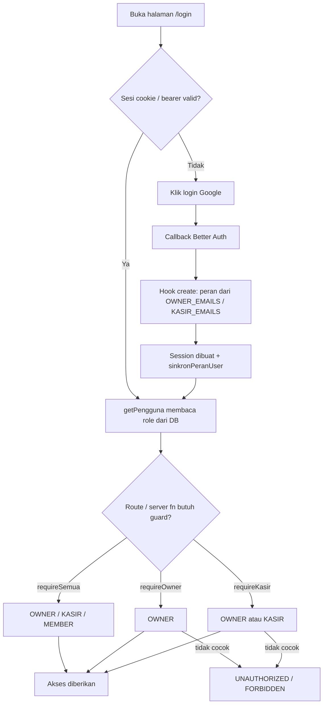
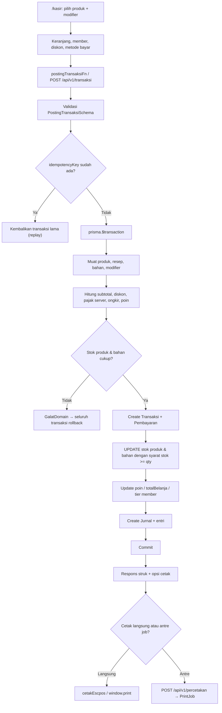
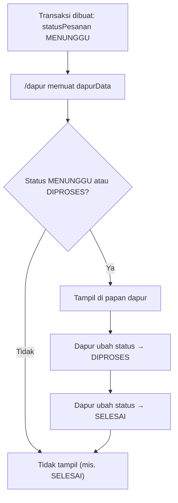
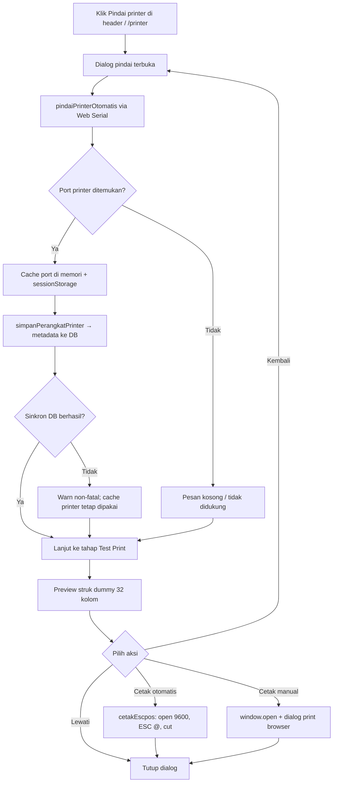
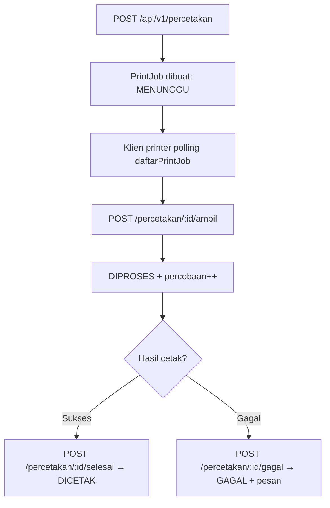

# Bukti Kode — Auth, Kasir, KDS, Printer

Referensi baris mengikuti kode saat dokumen ini dibuat.

## 1. Auth

**`src/lib/auth.ts:55`** — Better Auth + Google, email/password nonaktif:

```ts
// src/lib/auth.ts:55
export const auth = betterAuth({
  baseURL: env.BETTER_AUTH_URL,
  secret: env.BETTER_AUTH_SECRET,
  database: prismaAdapter(prisma, { provider: 'postgresql' }),
  // Email/password dimatikan: login hanya lewat Google, tanpa permukaan kredensial.
  emailAndPassword: { enabled: false },
```

```ts
// src/lib/auth.ts:87
  socialProviders: {
    google: {
      clientId: env.GOOGLE_CLIENT_ID ?? '',
      clientSecret: env.GOOGLE_CLIENT_SECRET ?? '',
    },
  },
```

**`src/lib/auth.ts:12`** — peran dari `OWNER_EMAILS` / `KASIR_EMAILS`, disinkronkan saat login:

```ts
// src/lib/auth.ts:12
// Peran dari daftar env: email di OWNER_EMAILS → OWNER, di KASIR_EMAILS → KASIR.
// Satu sumber kebenaran untuk pembuatan akun & sinkronisasi saat login.
function peranDariEmail(email: string): 'OWNER' | 'KASIR' | null {
  return peranDariEnv(email, {
    owner: env.OWNER_EMAILS,
    kasir: env.KASIR_EMAILS,
  })
}
```

```ts
// src/lib/auth.ts:39
if (user.roleManual) return
const target = peranDariEnv(user.email, daftar)
if (!target || target === user.role) return
if (user.role === 'OWNER') return
await prisma.user.update({ where: { id: userId }, data: { role: target } })
```

**`src/server/auth.ts:13`** — peran dibaca langsung dari DB:

```ts
// src/server/auth.ts:13
// Sumber kebenaran role: baca langsung dari DB (role bisa diubah setelah pembuatan akun)
const dbUser = await prisma.user.findUnique({
  where: { id: session.user.id },
  select: { role: true },
})
const role: Role = dbUser?.role ?? 'MEMBER'
```

**`src/server/auth.ts:29` / `:36`** — guard `requireKasir` / `requireOwner`:

```ts
// src/server/auth.ts:29
async function requirePeran(daftar: ReadonlyArray<Role>): Promise<Pengguna> {
  const pengguna = await getPengguna()
  if (!pengguna) throw new Error('UNAUTHORIZED')
  if (!daftar.includes(pengguna.role)) throw new Error('FORBIDDEN')
  return pengguna
}

export const requireKasir = () => requirePeran(AKSES.operasional)
export const requireOwner = () => requirePeran(AKSES.manajerial)
export const requireSemua = () => requirePeran(AKSES.semua)
```

```ts
// src/server/peran.ts:7
export const AKSES = {
  /** Operasional POS: pemilik & kasir (kasir, dapur, baca meja & pengaturan). */
  operasional: ['OWNER', 'KASIR'],
  /** Manajerial: pemilik saja (master data, laporan, tulis meja/pengaturan). */
  manajerial: ['OWNER'],
  /** Semua peran yang sudah login (analytics kunjungan). */
  semua: ['OWNER', 'KASIR', 'MEMBER'],
} as const satisfies Record<KunciAkses, readonly Role[]>
```

## 2. Kasir: transaksi + stok + jurnal atomik

**`src/server/postingTransaksi.ts:26`** — satu database transaction:

```ts
// src/server/postingTransaksi.ts:26
// Membuat transaksi + kurangi stok produk & bahan + tulis jurnal,
// semuanya dalam SATU database transaction.
export async function postingTransaksi(
  input: PostingTransaksiInput,
  kasirId?: string,
) {
  const data = PostingTransaksiSchema.parse(input)
```

```ts
// src/server/postingTransaksi.ts:43
  for (let percobaan = 1; percobaan <= 3; percobaan++) {
    try {
      return await prisma.$transaction(async (tx) => {
        // 1. Muat produk + resep + bahan + modifier grup
```

**`src/server/postingTransaksi.ts:245`** — stok produk & bahan dikurangi dengan syarat `stok >= qty`:

```ts
// src/server/postingTransaksi.ts:245
// 5. Kurangi stok produk & bahan secara atomik (satu query per tabel):
//    UPDATE bersyarat `stok >= qty` sehingga dua penjualan bersamaan
//    tidak bisa membuat stok negatif (OW-18). Bila baris terpengaruh
//    kurang dari yang diminta, batalkan seluruh transaksi.
if (qtyProduk.size > 0) {
  const nilai = Prisma.join(
    [...qtyProduk].map(
      ([id, qty]) => Prisma.sql`(${id}::text, ${qty.toString()}::int)`,
    ),
  )
  const terpengaruh = await tx.$executeRaw`
                      UPDATE "Produk" AS p
                      SET "stok" = p."stok" - v.qty
                      FROM (VALUES ${nilai}) AS v(id, qty)
                      WHERE p."id" = v.id AND p."stok" >= v.qty
                    `
  if (terpengaruh !== qtyProduk.size) {
    throw new GalatDomain('Stok produk tidak mencukupi')
  }
}
```

```ts
// src/server/postingTransaksi.ts:266
          if (qtyBahan.size > 0) {
            ...
            const terpengaruh = await tx.$executeRaw`
                      UPDATE "Bahan" AS b
                      SET "stok" = b."stok" - v.qty
                      FROM (VALUES ${nilai}) AS v(id, qty)
                      WHERE b."id" = v.id AND b."stok" >= v.qty
                    `
            if (terpengaruh !== qtyBahan.size) {
              throw new GalatDomain('Stok bahan baku tidak mencukupi')
            }
          }
```

**`src/server/postingTransaksi.ts:302`** — jurnal ditulis di `tx` yang sama:

```ts
// src/server/postingTransaksi.ts:302
const jurnal = await tx.jurnal.create({
  data: {
    nomor: await nomorBerikut(tx, 'jurnal', kodeHarian('JU')),
    keterangan: `Penjualan ${nomor}`,
    transaksiId: transaksi.id,
    entri: { create: entri },
  },
  include: { entri: { include: { akun: true } } },
})
```

## 3. KDS

**`src/server/dapur.ts:14`** — hanya `MENUNGGU` dan `DIPROSES`:

```ts
// src/server/dapur.ts:14
export async function dapurData() {
  const transaksi = await prisma.transaksi.findMany({
    where: {
      statusPesanan: { in: ['MENUNGGU', 'DIPROSES'] },
    },
    orderBy: [{ meja: { nomor: 'asc' } }, { tanggal: 'asc' }],
```

**`src/server/dapur.ts:66`** — status diubah lewat `updateStatusPesanan`:

```ts
// src/server/dapur.ts:66
export async function updateStatusPesanan(input: UpdateStatusPesananInput) {
  const data = UpdateStatusPesananSchema.parse(input)
  const lama = await prisma.transaksi.findUnique({ where: { id: data.id } })
  if (!lama) throw new GalatDomain('Transaksi tidak ditemukan')
  await prisma.transaksi.update({
    where: { id: data.id },
    data: { statusPesanan: data.statusPesanan },
  })
  return { id: data.id, statusPesanan: data.statusPesanan }
}
```

## 4. Printer: Web Serial + ESC/POS

**`src/lib/printer.ts:15`** — buka port 9600 baud, inisialisasi ESC/POS, cut:

```ts
// src/lib/printer.ts:15
export async function cetakEscpos(
  baris: string[],
  portPilihan?: PortSerial,
): Promise<void> {
  if (!dukunganSerial()) {
    throw new Error('Web Serial tidak didukung browser ini')
  }
  let port = portPilihan
  if (!port) {
    const hasil = await portUntukCetak()
    if (!hasil) {
      throw new Error(
        'Printer belum dipindai. Buka menu Pindai printer lalu hubungkan printer thermal.',
      )
    }
    port = hasil.port
  }
  await port.open({ baudRate: 9600 })
  if (!port.writable) {
    await port.close()
    throw new Error('Port printer tidak bisa ditulis')
  }
  const writer = port.writable.getWriter()
  try {
    const enc = new TextEncoder()
    const muatan: Uint8Array[] = []
    muatan.push(enc.encode(`${ESC}@`)) // inisialisasi printer
    for (const b of baris) {
      muatan.push(enc.encode(b.padEnd(32) + '\n'))
    }
    muatan.push(enc.encode('\n\n\n')) // advance kertas
    muatan.push(enc.encode(`${ESC}i`)) // potong kertas (full cut)
    for (const chunk of muatan) {
      await writer.write(chunk)
    }
  } finally {
    writer.releaseLock()
    await port.close()
  }
}
```

## 5. Master printer + antrean `PrintJob`

**`prisma/schema.prisma:752`** — model `Printer`:

```prisma
// prisma/schema.prisma:752
model Printer {
  ...
  userId          String?
  nama            String
  // "ESC_POS" (thermal 58mm) atau "RAW" (printer biasa).
  tipe            String    @default("ESC_POS")
  ...
  koneksi         String    @default("USB")
  ...
  default         Boolean   @default(false)
  ...
  jobs PrintJob[]
  ...
  @@unique([userId, perangkat])
}
```

**`prisma/schema.prisma:790`** — model `PrintJob` dan status antrean:

```prisma
// prisma/schema.prisma:790
model PrintJob {
  id             String     @id @default(cuid())
  printerId      String?
  printer        Printer?   @relation(fields: [printerId], references: [id], onDelete: SetNull)
  transaksiId    String?
  ...
  tipe           String     @default("STRUK")
  // "MENUNGGU" → "DIPROSES" → "DICETAK" | "GAGAL"
  status         String     @default("MENUNGGU")
  // Kunci idempotensi klien (retry tak bikin job ganda).
  idempotencyKey String?    @unique
  // Isi struk (JSON) — client pencetak merender sendiri ke ESC/POS.
  payload        Json?
  ...
}
```

**`src/server/percetakan.ts:584`** — job dibuat server dari transaksi:

```ts
// src/server/percetakan.ts:584
export async function buatPrintJob(
  input: BuatPrintJobInput,
  userId?: string,
): Promise<PrintJobRow> {
  const data = BuatPrintJobSchema.parse(input)

  if (data.idempotencyKey) {
    const ada = await prisma.printJob.findUnique({
      where: { idempotencyKey: data.idempotencyKey },
    })
    if (ada) return await muatJob(ada.id)
  }

  const payload = await muatPayloadStruk(data.transaksiId)
  if (!payload) throw new GalatDomain('Transaksi tidak ditemukan')

  const printerId = data.printerId ?? (await printerDefault(userId))?.id ?? null
```

**`src/server/percetakan.ts:687`** — klaim job dan transisi status:

```ts
// src/server/percetakan.ts:687
export async function ambilPrintJob(id: string): Promise<PrintJobRow> {
  const terambil = await prisma.printJob.updateMany({
    where: { id, status: 'MENUNGGU' },
    data: {
      status: 'DIPROSES',
      diambilPada: new Date(),
      percobaan: { increment: 1 },
    },
  })
  if (terambil.count !== 1) {
    throw new GalatDomain('Job sudah diambil atau tidak ada')
  }
  return await muatJob(id)
}
```

```ts
// src/server/percetakan.ts:703
export async function selesaiPrintJob(id: string): Promise<PrintJobRow> {
  ...
  await prisma.printJob.update({
    where: { id },
    data: { status: 'DICETAK', dicetakPada: new Date(), pesanGalat: null },
  })
  return await muatJob(id)
}
```

## 6. Flow chart

Diagram memakai Mermaid (render di GitHub/GitLab). Alur teks tetap ada di bagian 7.

### 6.1 Auth & peran



### 6.2 Transaksi kasir



### 6.3 KDS dapur



### 6.4 Quick scan + test print



### 6.5 Antrean `PrintJob`



## 7. Cara pakai

### 7.1 Login & peran

1. Buka `/login`, klik **Login dengan Google**.
2. Peran awal ditentukan `OWNER_EMAILS` / `KASIR_EMAILS`; akun lain menjadi `MEMBER`.
3. Owner bisa mengubah peran manual lewat `/user`; nilai `roleManual` tidak ditimpa env.
4. Akses halaman:
   - `/kasir`, `/dapur`, `/percetakan`: `OWNER` + `KASIR`.
   - `/printer`, master data, laporan: `OWNER`.

### 7.2 Transaksi kasir

1. Buka `/kasir`.
2. Pilih produk; atur qty dan modifier bila ada.
3. Pilih member (opsional); diskon member/poin dihitung server.
4. Pilih metode bayar: `TUNAI`, `QRIS`, `TRANSFER`, `KARTU`, atau `EWALLET`.
5. Untuk tunai, isi uang diterima; kembalian dihitung.
6. Klik bayar/simpan. Server memvalidasi ulang harga, pajak, stok, dan modifier.
7. Jika stok kurang, transaksi ditolak dan tidak ada data setengah tersimpan.
8. Setelah sukses, struk tampil dan bisa dicetak langsung atau masuk antrean `PrintJob`.

### 7.3 KDS dapur

1. Buka `/dapur`.
2. Pesanan baru berstatus `MENUNGGU` otomatis muncul.
3. Klik pesanan lalu ubah ke `DIPROSES` saat mulai dibuat.
4. Setelah siap/disajikan, ubah ke `SELESAI`; pesanan hilang dari papan dapur.
5. Tombol cetak struk menambah hitungan `cetakOwner` / `cetakKasir`.

### 7.4 Menghubungkan printer

1. Gunakan Chrome/Edge desktop yang mendukung Web Serial.
2. Login sebagai `OWNER` atau `KASIR`.
3. Klik tombol **Pindai printer** di header, atau buka `/printer` (khusus owner).
4. Izinkan browser mengakses port serial.
5. Jika port ditemukan, printer tersimpan di cache sesi dan metadatanya dikirim ke DB.
6. Pilih **Pakai** / **Hubungkan** bila ada beberapa printer.
7. Klik **Jadikan default** bila ingin dipakai otomatis.

### 7.5 Test print

1. Buka quick scan dari header, atau `/printer` lalu klik **Test print**.
2. Setelah pindai selesai, dialog test print muncul otomatis.
3. Periksa preview; isinya pesanan/member dummy dan bertanda `*** DATA UJI / DUMMY ***`.
4. Pilih:
   - **Cetak otomatis**: kirim ESC/POS langsung ke printer terpilih.
   - **Cetak manual**: buka dialog print browser, pilih printer thermal 58mm.
   - **Lewati**: tutup tanpa mencetak.
   - **Kembali**: kembali ke daftar printer.
5. Test print tidak membuat transaksi, tidak memotong stok, dan tidak menambah poin.

### 7.6 Antrean cetak (`PrintJob`)

1. Buat job: `POST /api/v1/percetakan` dengan `{ transaksiId, printerId?, tipe?, idempotencyKey? }`.
2. Job berstatus `MENUNGGU`; isi struk disusun server.
3. Klien pencetak memanggil `POST /api/v1/percetakan/:id/ambil` → `DIPROSES`.
4. Setelah berhasil: `POST /api/v1/percetakan/:id/selesai` → `DICETAK`.
5. Jika gagal: `POST /api/v1/percetakan/:id/gagal` dengan `{ pesan? }` → `GAGAL`.
6. Pantau antrean di `/percetakan` (OWNER/KASIR).

### 7.7 Jika muncul `[printer] sinkronisasi perangkat gagal`

1. Artinya metadata perangkat gagal disimpan ke DB, bukan berarti printer tidak bisa dipakai.
2. Printer dari cache sesi tetap bisa dipakai untuk test print dan cetak langsung.
3. `penyebab: 'Error'` = error JS biasa tanpa status HTTP dan bukan `TypeError`; tidak di-retry.
4. Jika `401/403`, itu sesi berakhir saat proses pindai dan sekarang tidak lagi diperingatkan.
5. Jika masih muncul, cek log server dengan `ref` terkait; biasanya error 5xx/DB saat sinkronisasi.
6. Coba login ulang lalu pindai ulang; muat ulang halaman bila cache sesi hilang.
