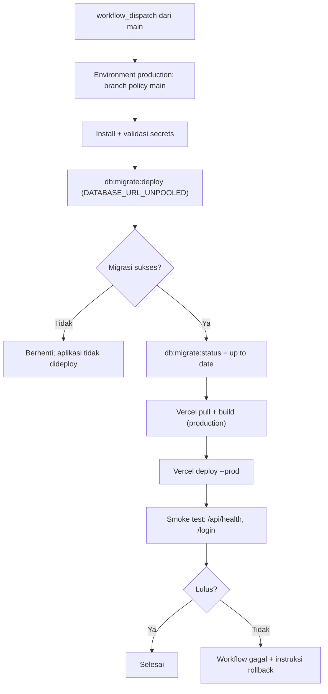

# Deploy Produksi — Vercel

Keputusan provider: **Vercel**. Netlify tetap tersimpan sebagai konfigurasi cadangan,
tetapi alur produksi hanya memakai Vercel.

## 1. Invarian

- Deploy produksi **hanya** lewat `.github/workflows/deploy-production.yml`
  (`workflow_dispatch` + environment `production`). Pada repo private GitHub Free,
  required reviewer tidak tersedia; gate yang aktif adalah dispatch manual oleh
  user ber-write access + branch policy `main`. Lihat §3.2.
- Urutan wajib: **migrasi sukses → deploy aplikasi → smoke test**.
- Auto-deploy `main` di Vercel dimatikan lewat `vercel.json`
  (`git.deploymentEnabled.main = false`) agar push ke `main` tidak pernah
  mendahului migrasi.
- `db:seed` **tidak boleh** dijalankan di produksi.
- Preview PR tetap memakai environment **Preview** Vercel dan database terpisah.

## 2. Alur



## 3. Prasyarat sekali-pasang

### 3.1 Environment Vercel

- Project Vercel terhubung ke repo `adhitiad/pos`.
- Build memakai `vercel.json`: `bun install`, `NITRO_PRESET=vercel`, Bun 1.x.
- Isi **Production** environment variables:

| Variabel                                    | Nilai                             |
| ------------------------------------------- | --------------------------------- |
| `DATABASE_URL`                              | koneksi Neon pooled untuk runtime |
| `BETTER_AUTH_URL`                           | `https://<domain-produksi>`       |
| `BETTER_AUTH_SECRET`                        | secret produksi                   |
| `GOOGLE_CLIENT_ID` / `GOOGLE_CLIENT_SECRET` | OAuth produksi                    |
| `OWNER_EMAILS` / `KASIR_EMAILS`             | daftar email peran                |
| `TRUSTED_ORIGINS`                           | origin produksi                   |
| `TRUST_PROXY`                               | `true`                            |
| `TRUST_PROXY_HOPS`                          | `1` (Vercel satu lapis proxy)     |

`TRUST_PROXY_HOPS` menghitung jumlah proxy tepercaya yang menambahkan
`X-Forwarded-For`. Verifikasi SEC-20: produksi aktif memakai Vercel
(`vercel.json`, preset Nitro Vercel), yaitu **satu lapis proxy**, jadi nilainya
`1` dan entri paling kanan XFF dipakai sebagai IP klien. Jika menambahkan
CDN/reverse proxy lain di depan Vercel, naikkan sesuai jumlah lapisan yang
benar-benar menambahkan header; jangan menebak.

`DATABASE_URL_UNPOOLED` tidak dibutuhkan runtime Vercel; nilainya disimpan sebagai
secret GitHub untuk migrasi.

### 3.2 GitHub Environment

Buat dua environment:

| Environment  | Protection                                                  | Secrets                                                                                      |
| ------------ | ----------------------------------------------------------- | -------------------------------------------------------------------------------------------- |
| `production` | Branch policy `main`; required reviewer bila plan mendukung | `DATABASE_URL_UNPOOLED`, `VERCEL_TOKEN`, `VERCEL_ORG_ID`, `VERCEL_PROJECT_ID`                |
| `preview`    | Tanpa reviewer                                              | `DATABASE_URL` + `DATABASE_URL_UNPOOLED` database preview (untuk workflow preview mendatang) |

Status saat ini: kedua environment sudah dibuat lewat API; `production` memakai
branch policy `main`, tetapi empat secret produksi dan database preview belum
diisi.
**Required reviewer tidak bisa diaktifkan pada repo private GitHub Free** — API
mengembalikan 422 `billing plan supports the required reviewers protection rule`.
**Keputusan:** gate produksi = `workflow_dispatch` manual dari `main` oleh user
ber-write access + branch policy `main`. Bila plan di-upgrade, tambahkan required
reviewer di **Settings → Environments → production**, atau lewat API:

```bash
gh api --method PUT repos/adhitiad/pos/environments/production \
  --input environment-production.json
```

Isi `environment-production.json` (ganti `12345678` dengan ID user GitHub yang
menjadi reviewer):

```json
{
  "reviewers": [{ "type": "User", "id": 12345678 }],
  "deployment_branch_policy": {
    "protected_branches": false,
    "custom_branch_policies": true
  }
}
```

Jangan commit file itu bila memuat data internal.

Mengisi secret (nilai tidak ditulis ke repo/log):

```bash
printf '%s' "$DATABASE_URL_UNPOOLED" | gh secret set DATABASE_URL_UNPOOLED --env production
printf '%s' "$VERCEL_TOKEN" | gh secret set VERCEL_TOKEN --env production
printf '%s' "$VERCEL_ORG_ID" | gh secret set VERCEL_ORG_ID --env production
printf '%s' "$VERCEL_PROJECT_ID" | gh secret set VERCEL_PROJECT_ID --env production
```

Jangan menaruh secret produksi di environment `preview`, dan sebaliknya.

### 3.3 Bootstrap auto-deploy

`git.deploymentEnabled` dibaca dari deployment; jangan mengandalkan konfigurasi
itu untuk push yang pertama kali memperkenalkannya. Sebelum push yang membawa
migration baru, pilih salah satu:

- Push **hanya** perubahan `vercel.json` (tanpa migration/kode baru), tunggu
  auto-deploy selesai, lalu pastikan push berikutnya tidak memicu deployment
  produksi. Setelah itu baru push workflow + migration.
- Atau ubah **Production Branch** Vercel sementara ke branch non-`main`, push
  semua perubahan, jalankan deploy manual, lalu kembalikan Production Branch ke
  `main`. Konfigurasi `git.deploymentEnabled.main = false` sudah aktif setelah
  deploy manual itu.

Jangan push migration baru ke `main` sebelum auto-deploy produksi benar-benar
mati.

### 3.4 Google OAuth

Tambahkan redirect URI produksi:

```text
https://<domain-produksi>/api/auth/callback/google
```

## 4. Menjalankan deploy

```bash
gh workflow run deploy-production.yml
gh run watch
```

Workflow akan:

1. Menunggu approval environment `production` bila required reviewer aktif;
   saat ini gate-nya adalah dispatch manual dari branch `main`.
2. Memvalidasi keempat secret; gagal cepat bila ada yang kosong.
3. Menulis `.env.local` sementara (hanya `DATABASE_URL_UNPOOLED`) lalu
   menjalankan `bun run db:migrate:deploy`.
4. Menjalankan `bun run db:migrate:status`.
5. Menghapus `.env.local` (juga saat gagal).
6. `vercel pull`, `vercel build --prod`, `vercel deploy --prebuilt --prod`.
7. Menjalankan `scripts/smoke-deploy.sh <url-deploy>`.

Tidak ada langkah `db:seed`.

## 5. Smoke test

`scripts/smoke-deploy.sh` memeriksa:

- `GET /api/health` → HTTP 200 dan `database: "ok"` (retry sampai ~2,5 menit).
- `GET /login` → HTTP 200 dan halaman memuat tombol Google.

Uji manual:

```bash
bash scripts/smoke-deploy.sh https://<domain-produksi>
```

`db:migrate:status` sudah dijalankan sebelum deploy; bila status bukan
“up to date”, workflow berhenti sebelum aplikasi dideploy.

## 6. Rollback

### 6.1 Aplikasi

Jika smoke test gagal setelah deploy:

1. Buka Vercel Dashboard → Project → Deployments.
2. Pilih deployment produksi terakhir yang sehat → **Promote to Production**.
3. Atau lewat CLI:

```bash
bunx vercel rollback <url-deployment-sehat> --token="$VERCEL_TOKEN"
```

Deploy ulang tidak otomatis menjalankan migrasi; jangan deploy versi lama ke
skema yang sudah tidak kompatibel.

### 6.2 Database (expand/contract)

Migrasi produksi tidak memakai `down`. Gunakan pola expand/contract:

1. **Expand**: tambah kolom/tabel/index baru yang kompatibel dengan versi lama.
2. Deploy aplikasi yang sudah memakai struktur baru.
3. **Contract**: hapus kolom/tabel lama pada rilis berikutnya setelah yakin tidak
   dipakai.

Untuk perubahan destruktif yang sudah terlanjur:

1. Restore branch Neon ke titik waktu sebelum migrasi (PITR).
2. Verifikasi tabel inti (`Transaksi`, `Jurnal`, `Stok`).
3. Repoint `DATABASE_URL`/`DATABASE_URL_UNPOOLED` ke branch hasil restore.
4. Rollback aplikasi ke versi sebelumnya.

### 6.3 Migrasi gagal

Workflow berhenti sebelum deploy. Aplikasi produksi tetap versi lama. Perbaiki
migrasi di branch, buka PR, lalu jalankan workflow lagi. Jangan memaksa deploy
aplikasi baru sebelum migrasi sukses.

## 7. Checklist pertama kali

- [ ] Vercel project terhubung dan environment Production terisi.
- [ ] Auto-deploy `main` sudah dimatikan (bootstrap §3.3), bukan hanya di
      `vercel.json` yang belum pernah dideploy.
- [ ] GitHub environment `production` punya branch policy `main`.
- [ ] Required reviewer aktif bila plan GitHub mendukung.
- [ ] Empat secret produksi terisi.
- [ ] Database preview terpisah untuk environment `preview`.
- [ ] `DATABASE_URL_UNPOOLED` mengarah ke koneksi langsung Neon, bukan pooled.
- [ ] Redirect URI Google produksi ditambahkan.
- [ ] Workflow dijalankan dan smoke test lulus.
- [ ] Uptime monitor menunjuk `/api/health`.

## 8. Troubleshooting

| Gejala                                    | Penyebab umum                                                 | Tindakan                                                                       |
| ----------------------------------------- | ------------------------------------------------------------- | ------------------------------------------------------------------------------ |
| `Secret ... belum diset`                  | environment belum diisi                                       | isi secret di environment `production`                                         |
| `Failed to create ... required reviewers` | repo private GitHub Free tidak mendukung required reviewer    | pakai dispatch manual + branch policy, atau upgrade plan                       |
| Migrasi gagal                             | koneksi direct salah / migration rusak                        | cek `DATABASE_URL_UNPOOLED`, jalankan `db:migrate:status` lokal ke DB produksi |
| Health 503                                | database tidak terjangkau                                     | cek Neon, pooled URL, IP allowlist                                             |
| Health 200 tapi login gagal               | OAuth/`BETTER_AUTH_URL` salah                                 | cocokkan redirect URI dan `TRUSTED_ORIGINS`                                    |
| `URL deployment tidak ditemukan`          | output CLI Vercel berubah                                     | cek log job, gunakan `vercel inspect`                                          |
| Deploy jalan sebelum migrasi              | auto-deploy Vercel masih aktif / config belum pernah dideploy | lakukan bootstrap §3.3 sebelum push migration                                  |
| Workflow dobel                            | dua run manual bersamaan                                      | `concurrency: deploy-production` menjaga antrean, jangan cancel manual         |
